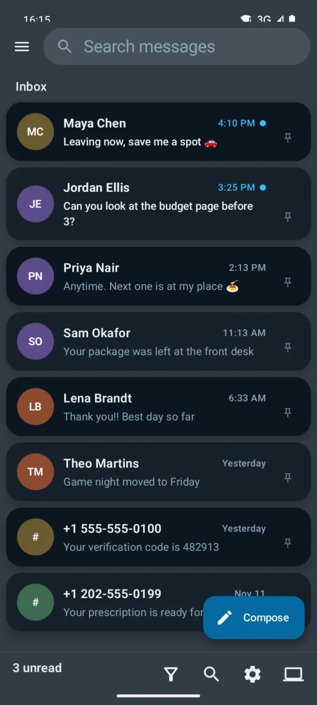
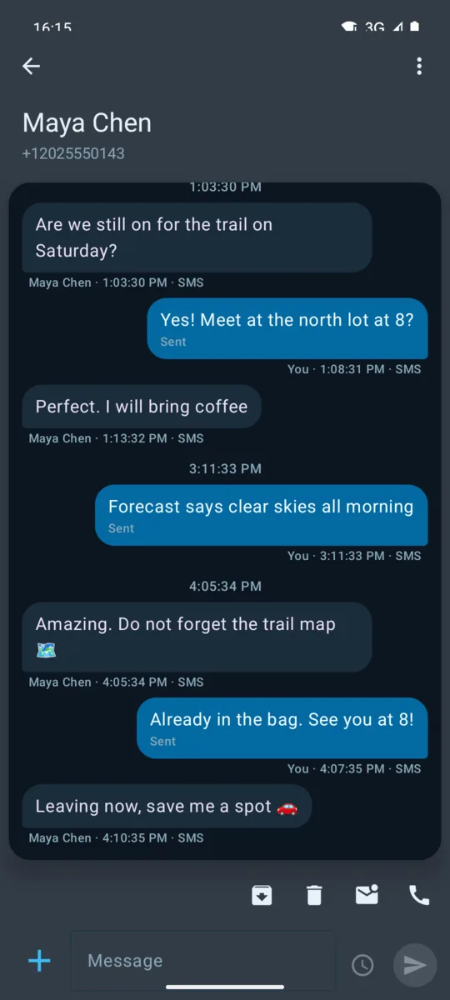
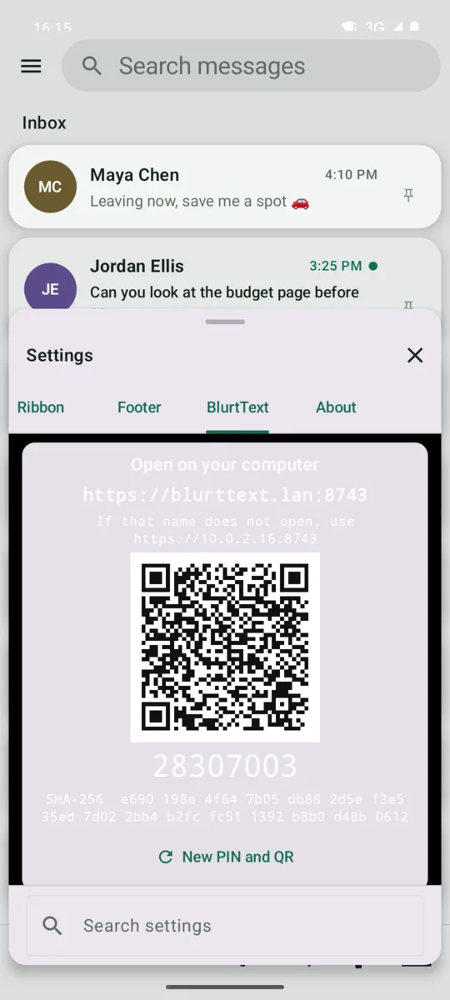
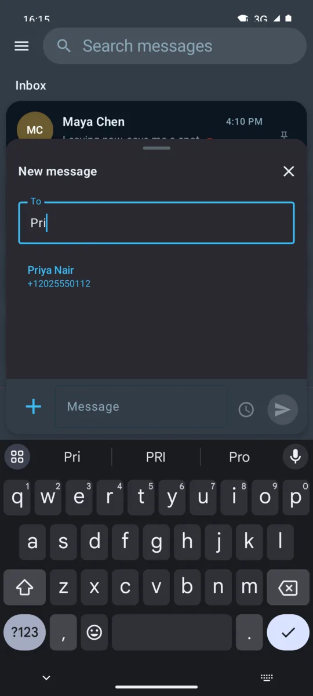
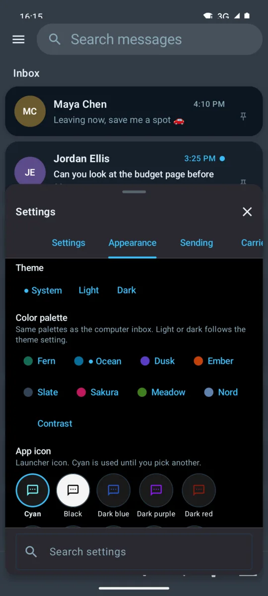
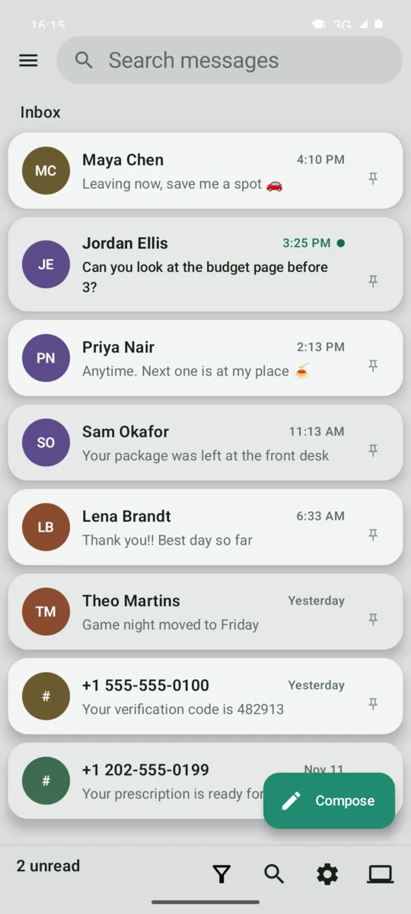

# BlurtText

An SMS and MMS app for Android with a private computer inbox on your own Wi-Fi.

Set BlurtText as your default texting app, then open `https://blurttext.lan:8743` on a computer on the same Wi-Fi to read and reply from a real keyboard. No account, no cloud, and message bodies never leave your network.

  
  
  

## Download

Get `blurttext-<version>.apk` from **[Releases](https://github.com/crome1394/blurttext-android/releases/latest)**, install it, and set BlurtText as the default SMS app. Android 8.0 or newer on a phone with telephony. An F-Droid listing is [in preparation](F-DROID.md).

## Features

| | |
|---|---|
| **Messaging** | SMS, long SMS, and MMS (pictures, GIFs, video, voice) through Android's own message store; no carrier SDK |
| **Groups** | A group stays in one thread, and a reply goes to everyone |
| **Inbox** | Swipe to delete or mark read/unread, with undo from Trash; pin, archive, search, filter |
| **Sending** | Multi-SIM, scheduled texts, attach a photo or your location |
| **Blocking** | Block list and keyword filter |
| **Look** | Nine color palettes, light and dark, launcher icon colors, text size |
| **Computer inbox** | Browser inbox on allowed Wi-Fi networks, paired by PIN or QR; stops when the phone leaves |
| **GIFs** | Optional KLIPY search when you save your own key |

## Screenshots

| New message | Appearance | Light theme |
|:---:|:---:|:---:|
|  |  |  |

Screenshots use made-up contacts and messages on the Android emulator.

## Quick start

1. Install the APK and accept the default-SMS prompt.
2. **Settings → BlurtText**: turn on **Web access** and allow your home Wi-Fi.
3. Open the address shown on the phone in a browser, accept the certificate once, and enter the PIN.

## Documentation

| Doc | What's in it |
|---|---|
| [Compatibility](docs/compatibility.md) | Android versions, per-version features, permissions |
| [Building and releasing](docs/building.md) | Build, default-SMS commands, signed release steps |
| [Architecture](ARCHITECTURE.md) | Modules, screens, sending and receiving, group threads |
| [F-Droid](F-DROID.md) | Reproducible-build setup and submission checklist |
| [Changelog](CHANGELOG.md) | What changed in each release |

## License

Apache License 2.0. See [LICENSE](LICENSE) and [NOTICE](NOTICE). The computer inbox is [LanText](https://github.com/crome1394/LanText), included as a submodule.
